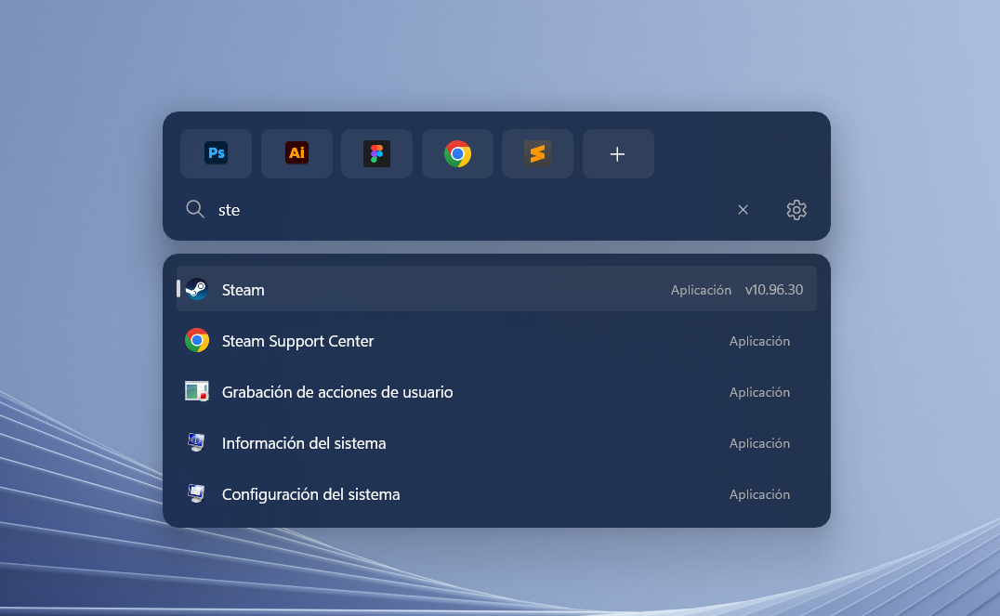

<p align="center">
  
</p>

<h1 align="center">FinderCast</h1>

<p align="center">
  Lanzador rápido de aplicaciones para Windows 11, al estilo de Raycast y Tinycast en macOS.<br>
  Pulsa el atajo, escribe y pulsa Enter.
</p>

<p align="center">
  
</p>

---

## Uso

| Acción | Atajo |
| --- | --- |
| Abrir o cerrar el lanzador | `Alt` `Espacio` (se cambia en los ajustes) |
| Moverse por los resultados | `↑` / `↓` |
| Abrir el resultado elegido | `Enter` o clic |
| Copiar un emoji o símbolo | `:` y su nombre, por ejemplo `:corazon` o `:flecha` |
| Ejecutar un comando de consola | `>` y el comando, por ejemplo `> ipconfig /all` |
| Abrir como administrador | `Ctrl` `Enter` (se cambia en los ajustes) |
| Anclar una app arriba (hasta 6) | `+` con la app elegida, o clic derecho en el resultado |
| Quitar una app anclada | Clic derecho en ella |
| Cerrar | `Esc`, o hacer clic fuera |

Busca entre los accesos directos del menú Inicio (los del usuario y los de todos los usuarios), las
apps de Microsoft Store y
entre sus propios comandos: *Ajustes de FinderCast* y *Salir de FinderCast*. No hace falta escribir
el nombre entero ni con tildes, y perdona errores de tecleo: `vsc` encuentra *Visual Studio Code*,
`configuracion` encuentra *Configuración* y `discrod` encuentra *Discord*. Las apps que más abres suben en la lista.

La app se queda en segundo plano con un icono en el área de notificación: un clic abre los
ajustes y el clic derecho muestra *Abrir FinderCast* y *Salir*. Si ocultas el icono, volver a
abrir FinderCast desde el menú Inicio muestra los ajustes.

## Ajustes

- Abrir al iniciar Windows (activado la primera vez).
- Mostrar el icono en la bandeja.
- Mostrar las 5 últimas apps abiertas al abrir el lanzador sin escribir nada (desactivado por defecto).
- Idioma: español o inglés (por defecto, el de Windows). Cambia al momento, sin reiniciar.
- Abrir como administrador: se graba igual, con una o más modificadoras y `Enter`.
- Atajo para abrir: haz clic en las teclas y pulsa la nueva combinación (`Esc` cancela). Si otra
  app ya lo usa, FinderCast lo avisa y conserva el anterior.

> PowerToys Run también usa `Alt` `Espacio` por defecto. Si lo tienes activo, cambia el atajo de
> uno de los dos.

## Descargar

1. Descarga `FinderCast-<versión>-portable.zip` desde [Releases](../../releases).
2. Descomprímelo donde quieras y abre `FinderCast.exe`.

No hace falta instalar nada: el programa lleva dentro .NET y el Windows App SDK. La primera vez
tarda un poco más en abrirse, porque prepara sus partes en la carpeta temporal. Para quitarlo,
usa **Salir** en el menú de la bandeja y borra el `.exe`. Como el ejecutable no está firmado, la
primera vez Windows SmartScreen puede pedir confirmación (*Más información → Ejecutar de todas formas*).

**Requisitos:** Windows 10 (versión 2004 o posterior) u 11, de 64 bits. Acrylic y Mica se ven en
Windows 11.

## Compilar

Requisitos: SDK de .NET 10, Windows 10 2004 o posterior, x64. El material Acrylic del lanzador y
el Mica de los ajustes se ven en Windows 11.

```bash
dotnet build
```

El ejecutable queda en `src/FinderCast/bin/Debug/net10.0-windows10.0.19041.0/win-x64/FinderCast.exe`.
Lleva el Windows App SDK dentro, así que no hace falta instalar nada más.

Paquete de una versión: un único `FinderCast.exe` comprimido, en
`artifacts/FinderCast-<versión>-portable.zip` (la versión sale de `Directory.Build.props`):

```bash
powershell -ExecutionPolicy Bypass -File scripts/publicar.ps1
```

## Estructura

```
src/FinderCast/
  Program.cs              Entrada: una sola instancia; la segunda pide mostrar los ajustes.
  App.xaml(.cs)           Arranque: ajustes, índice, ventanas, atajo global y bandeja.
  MainWindow.xaml(.cs)    El lanzador: Acrylic, sin bordes, apps ancladas y búsqueda.
  ResultsWindow.xaml(.cs) Tarjeta de resultados bajo la búsqueda: lista de apps o cuadrícula de emojis.
  SettingsWindow.xaml(.cs) Ajustes con la construcción de la ventana de ShutterGrid, sobre Mica.
  Controls/               Controles de los ajustes dibujados a mano como en ShutterGrid: interruptor
                          de shadcn/ui con muelle, botón y menú desplegable de Arc UI, información
                          emergente de shadcn/ui y selector de atajo con teclas sueltas.
  Themes/                 Paleta, tipografía, teclas y las curvas y muelles de las animaciones
                          (sistema de diseño de ShutterGrid).
  Services/               Índice del menú Inicio, búsqueda, atajo global y su grabador,
                          bandeja, inicio con Windows, textos e idioma, ajustes en JSON.
  Interop/                Win32: ventana de mensajes, iconos del Shell y funciones nativas.
design/FinderCast.svg     Icono original (Assets/ tiene el .ico y el .png generados a partir de él).
```

Los ajustes se guardan en `%APPDATA%\FinderCast\settings.json`.

## Licencia

FinderCast se distribuye bajo la [licencia MIT](LICENSE). Los nombres de los emojis salen de
emojibase-data, también MIT: ver [THIRD-PARTY-NOTICES.md](THIRD-PARTY-NOTICES.md).
